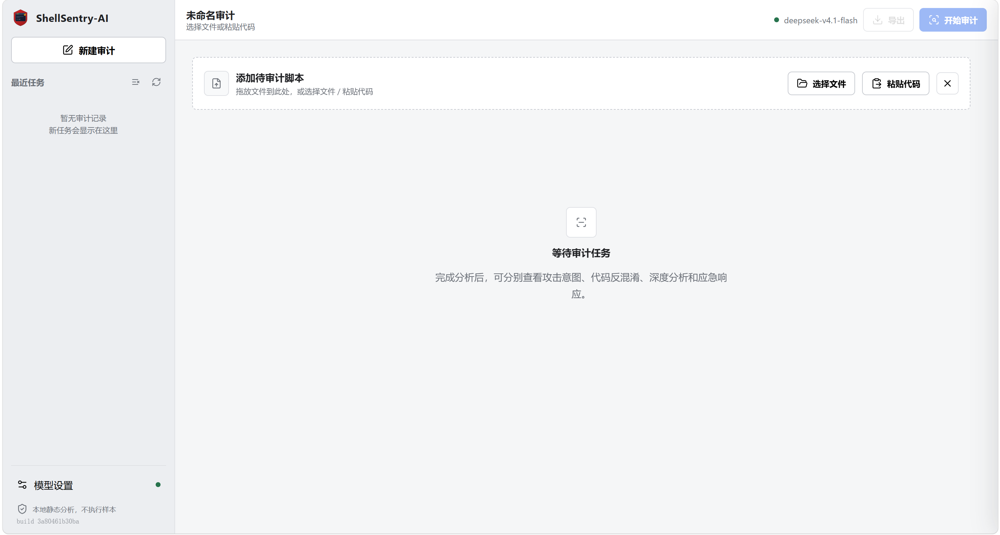
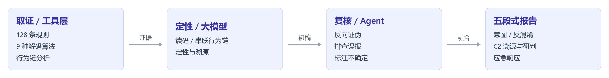

# ShellSentry-AI

<p align="center">
  <a href="LICENSE"></a>
  
  
  
  
</p>

**确定性取证 × 大模型定性 × Agent 反证复核的恶意代码审计智能体。**

它不是特征库匹配器，而是一个走完「**取证 → 定性 → 复核**」才下结论的 Agent：确定性工具（规则 / 解码 / 行为链）先固定证据，大模型在证据之上推理定性，再经 **Agent 反证复核**（主动证伪、排除误报）。全程**零执行、不落盘**，样本代码只发往**你自己指定**的模型接口。

覆盖 PHP / Java·JSP / ASP·ASPX / C# / Python / JavaScript / Ruby / Shell / Go 等语言，共 **128 条**检测规则（含 **30 条**跨语言通用规则）、**9 种**程序化解码算法。

<p align="center"></p>

---

## 为什么是「智能体」而不是扫描器

| | 规则扫描器 | ShellSentry-AI |
|---|---|---|
| 产出 | 报出命中的规则 | 读码定性 —— 命中只是**线索**，需交叉验证、给良性反证 |
| 证据 | 只看关键词 | 先做**确定性还原**（**非 LLM 推断**）再交模型解读 |
| 不确定 | 照报 | **标注「需运行时验证 / 认不出来」，绝不编造** |
| 复核 | 无 | **Agent 反证复核**：主动证伪、排除误报后才下结论 |

## 智能体的工作循环

<p align="center"></p>

- **工具层**（不需 API Key）：规则扫描、行为链分析、程序化解码 —— 结果确定、可复现；也是 `shellsentry scan` 单独提供的纯静态能力（**输出 JSON**）。
- **推理 + 复核层**（需 API Key）：大模型在证据上解读定性，Agent 再对初稿证伪、排查误报，最后与确定性结论融合。

> 未配置并启用大模型时，审计不会启动，会提示先在「模型设置」中完成配置。

## 它能做什么

| 能力 | 说明 |
|------|------|
| **静态规则扫描** | 128 条规则覆盖编码解码、动态执行、反弹 Shell、持久化、C2 外联、DOM XSS 等 9 类威胁行为，映射 12 项 CWE |
| **反混淆还原** | Base64 / Hex / ROT13 / URL / PowerShell ps_encoded / gzip / XOR 暴破 / charcode 拼接，**9 种算法程序化解码**；变量级混淆（`$a=[0]."sys"."tem"`）由模型语义补全 |
| **行为链分析** | Source → Propagation → Sink 完整闭环判定，能区分「有漏洞的业务代码」与「植入的恶意代码」 |
| **家族识别** | 识别 Behinder / Godzilla / AntSword / 天蝎 / Cobalt Strike / Metasploit / Viper / 挖矿投递等，**并区分「认不出来」**——不确定时输出空而非猜测 |
| **五段式报告** | 攻击意图定性 · 反混淆源码 · C2 通信溯源 · 威胁行为研判 · 可执行应急响应（IOC / Snort 规则 / 主机清扫 / 安服口径） |

## 可信边界

智能体只做静态判断，看不到运行环境与调用上下文，误报与漏报无法完全避免，重要结论请人工复核。内置盲测样本集 `zz_samples/`（7 个样本可复现），可自行复跑核对。

## 安全模型

**「零执行」的确切含义**：工具把待审文件当**纯文本**读取分析，**从不运行、从不编译、从不加载、从不反序列化**样本 —— 无论它是 PHP 一句话、JSP/Java 内存马（class 字节码）、ASPX、PowerShell 还是 Shell。整条链路没有任何 `eval` / `exec` / `subprocess` / `pickle` 之类的执行入口；ZIP 也在内存中解包，不落盘。样本因此**只可能被「读」，不可能被「跑」**。

- 样本内容**只在本机内存中读取**：既不执行，也**不写入磁盘**；历史记录只留报告与元数据，**不含样本源码**
- 代码内容只发往**你自己指定**的大模型接口，不经过任何第三方中转
- 审计界面与配置**只监听 `127.0.0.1`**，默认不对外网开放
- 配置与审计记录存放在系统用户数据目录（Windows `%LOCALAPPDATA%` / macOS `~/Library/Application Support` / Linux `$XDG_DATA_HOME`），不入库

### 部署须知（重要）

- **访问控制** —— 界面面向单机使用，**无身份认证**，默认仅监听 `127.0.0.1`。如需对外监听或经反向代理暴露，**必须自行增加访问控制**（SSH 隧道 / 认证代理等），否则历史记录与模型配置可被任意访问。
- **数据出站** —— 样本内容会发送至「模型设置」中配置的 `Base URL`，请确保该端点可信。
- **处置提醒** —— 工具不执行样本；报告与导出的「反混淆源码」仍属恶意样本，请勿在真实环境运行。

## 快速开始

```bash
# Windows：双击 start-shellsentry.cmd
# Linux / macOS：
chmod +x start-shellsentry.sh && ./start-shellsentry.sh
```

脚本自动创建项目内独立环境、安装依赖、启动本地界面（默认 `127.0.0.1:8765`，端口占用时自动避让）。

**首次使用需配置大模型 API**：点击界面左侧栏底部的「模型设置」，填入 Base URL、API Key、模型名（支持任意 OpenAI 兼容接口），再点「测试连接」确认可用。

命令行另有纯静态扫描（只跑规则与解码，不需要 API Key，输出 JSON）：

```bash
pip install -e .
shellsentry serve                # 启动 Web 界面（完整智能体审计，需 API Key）
shellsentry scan suspicious.php  # 静态扫描单个文件，输出 JSON
```

若 `pip install -e .` 报 `File "setup.py" or "setup.cfg" not found`，是 pip 版本过旧——早于 21.3 的 pip 不支持从 `pyproject.toml` 做 editable 安装。先执行 `python -m pip install -U pip` 再装即可（启动脚本已自动处理这一步）。

## 免责声明

本工具仅用于**授权范围内**的安全审计与防御。误报与漏报不可避免，重要结论请人工复核。

## License

Apache-2.0
